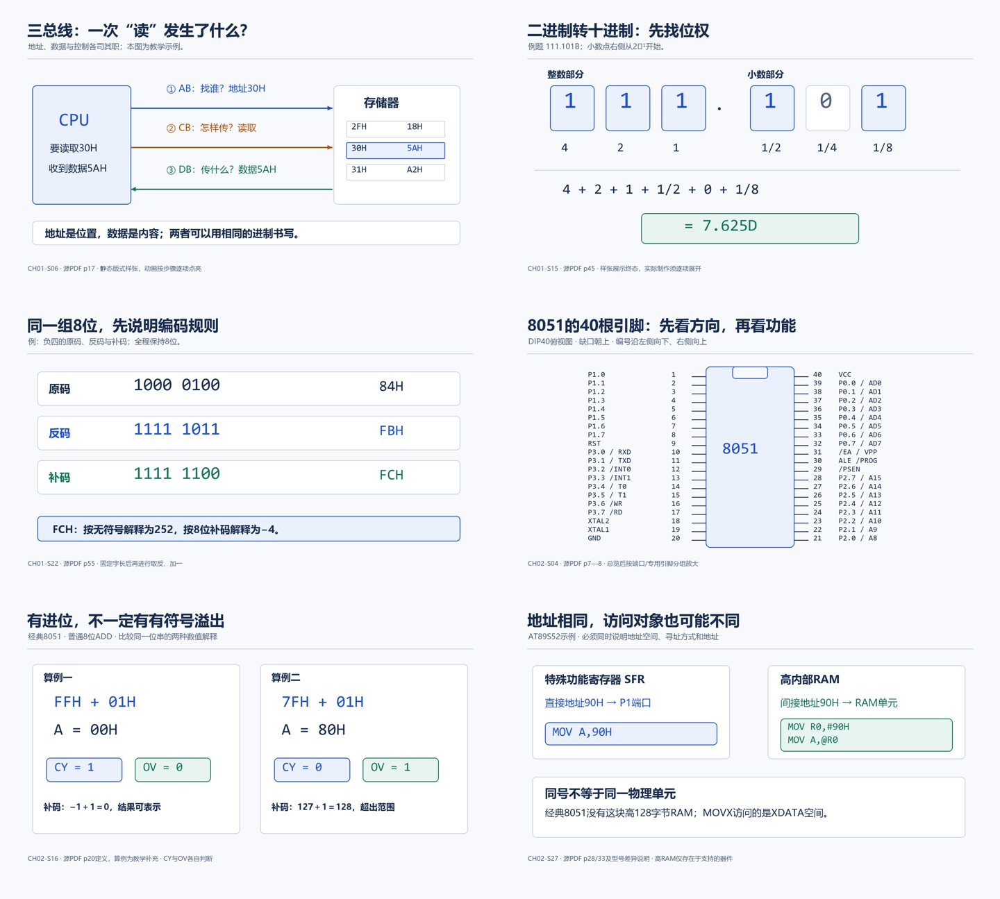
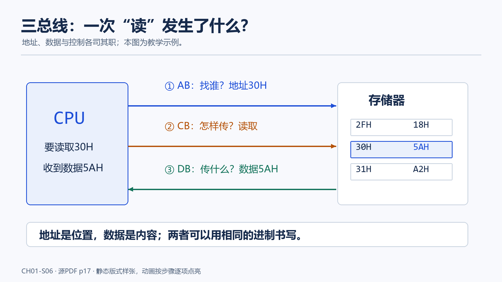
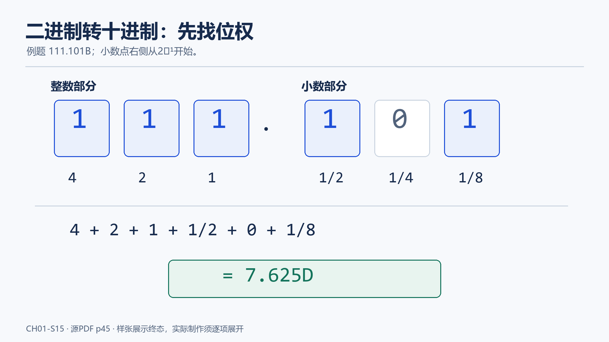
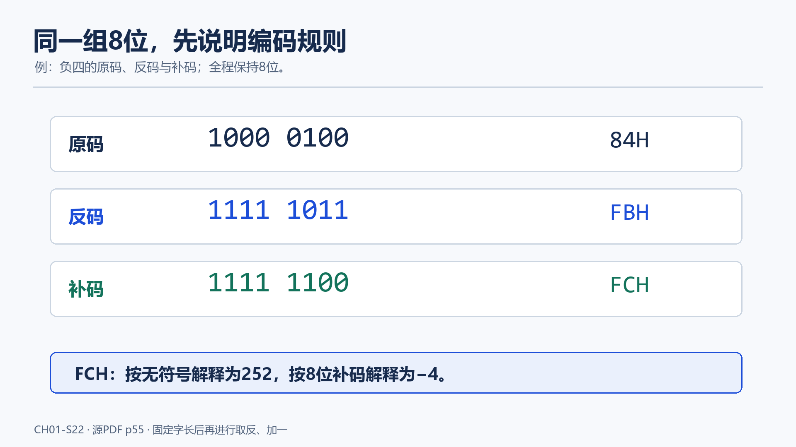
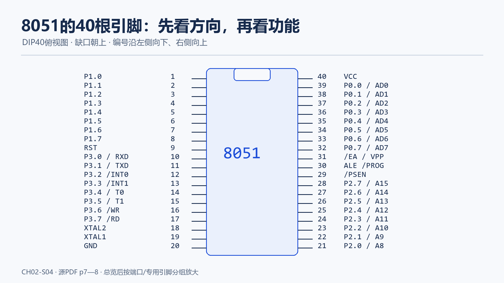
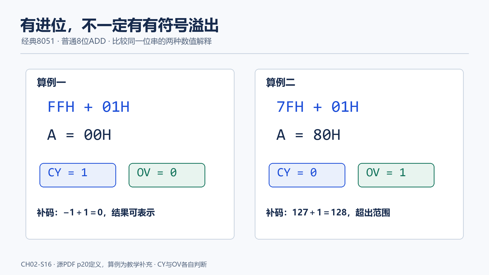
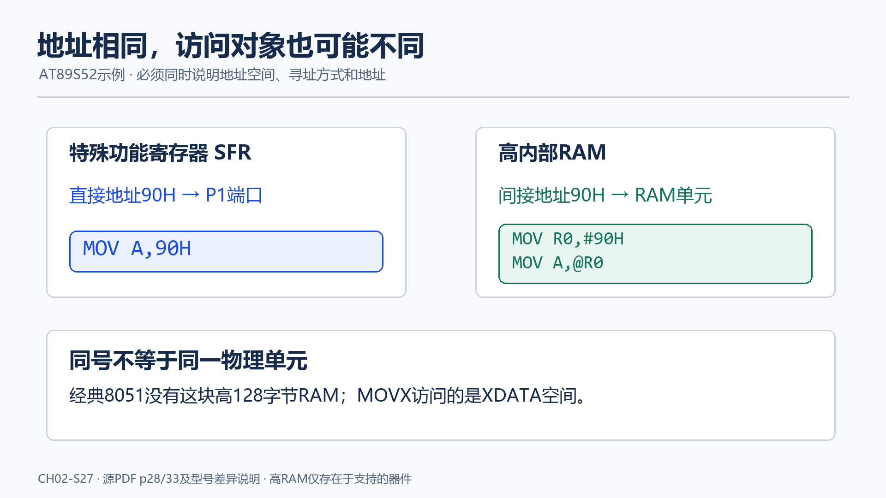

# 关键画面样张

六张原创1920×1080静态版式样张用于确认主要数字、箭头、表格和边界是否清楚。PNG可直接预览，旁边同名SVG可继续编辑；PNG为本次人工检查的可视基准，SVG在不同设备上的字体应重新核对。正式视频按各段分镜逐步展示，不一次把整张终态灌给学生。

## 第一章

### CH01-S06：地址、数据、控制

[可编辑SVG](ch01-buses.svg)。对应源PDF p17；30H与5AH是教学示例。

### CH01-S15：二进制位权

[可编辑SVG](ch01-place-value.svg)。对应源PDF p45；实际动画先显示位权，再点亮为1的项，最后给出7.625。

### CH01-S22：负四的编码

[可编辑SVG](ch01-complement.svg)。对应源PDF p55；实际动画按原码、反码、补码依次形成。

## 第二章

### CH02-S04：DIP40俯视引脚图

[可编辑SVG](ch02-pinout.svg)。对应源PDF p7—8；完整图用作定位，细讲时按组放大。`/INT0`、`/INT1`、`/WR`、`/RD`、`/EA`、`/PROG`、`/PSEN`用前缀斜线表示低有效；最终电路画面可统一改为上划线。

### CH02-S16：CY与OV的区别

[可编辑SVG](ch02-cy-ov.svg)。依据源PDF p20定义构造算例；以普通8位ADD为前提。

### CH02-S27：AT89S52的高RAM与SFR

[可编辑SVG](ch02-memory.svg)。衔接源PDF p28/p33及AT89S52资源差异；本画面的高RAM不能套到经典8051。
